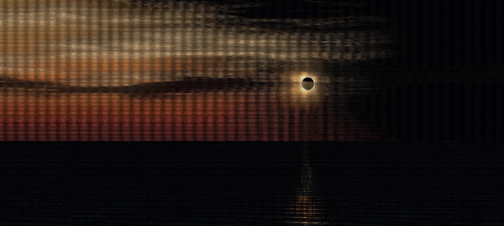
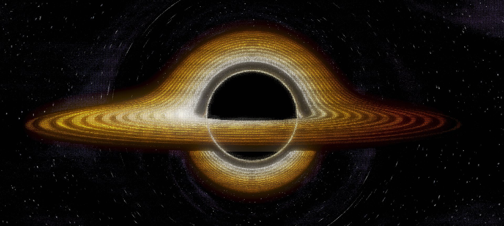

# ASCII Art by Chukite

Two interactive ASCII artworks: **Annulus** and **Singularity**.

[Open the gallery](https://ascii.chukite.me) · [Download both projects](https://ascii.chukite.me/downloads/ascii-field-notes.zip)

## Annulus

An annular eclipse over a moving sea.

<details>
<summary>Preview image</summary>

[](https://ascii.chukite.me/annulus-cinematic/dist/index.html)

</details>

[Open Annulus](https://ascii.chukite.me/annulus-cinematic/dist/index.html) · [Download project](https://ascii.chukite.me/downloads/annulus-cinematic.zip)

## Singularity

A black hole and its gravitationally lensed accretion disk.

<details>
<summary>Preview image</summary>

[](https://ascii.chukite.me/singularity-zoom-text/dist/index.html)

</details>

[Open Singularity](https://ascii.chukite.me/singularity-zoom-text/dist/index.html) · [Download project](https://ascii.chukite.me/downloads/singularity-zoom-text.zip)

## Run locally

Clone this repository and start a static server from the root:

```sh
python -m http.server 8000
```

Visit `http://localhost:8000`. No build step or package installation is needed.

For an individual project download, extract the ZIP and run the same command from its `dist/` folder. Use a modern browser with WebGL 2 support. Annulus uses JavaScript modules and needs a web server rather than a `file://` URL.

## License

Released under the [MIT License](LICENSE). You may reuse, modify, and redistribute the projects under its terms.
